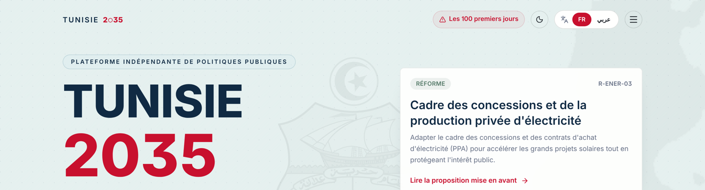
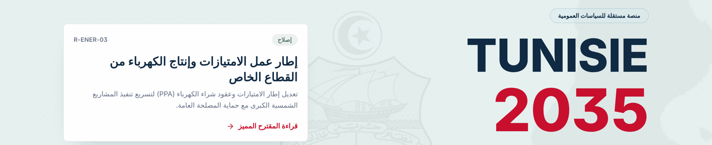
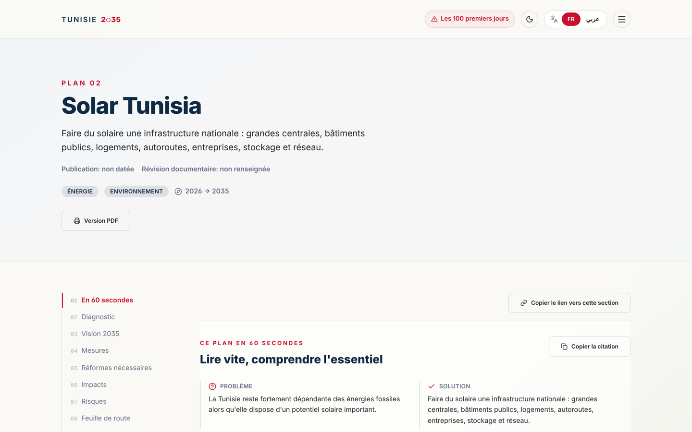
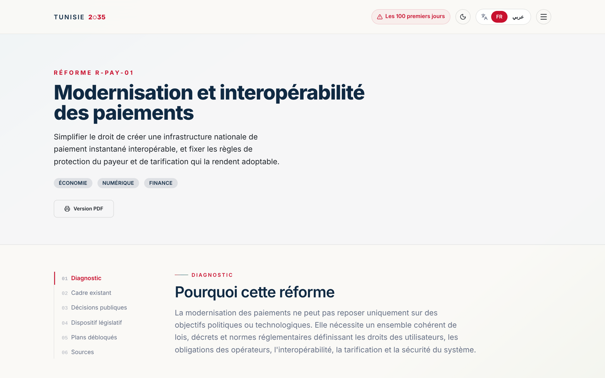
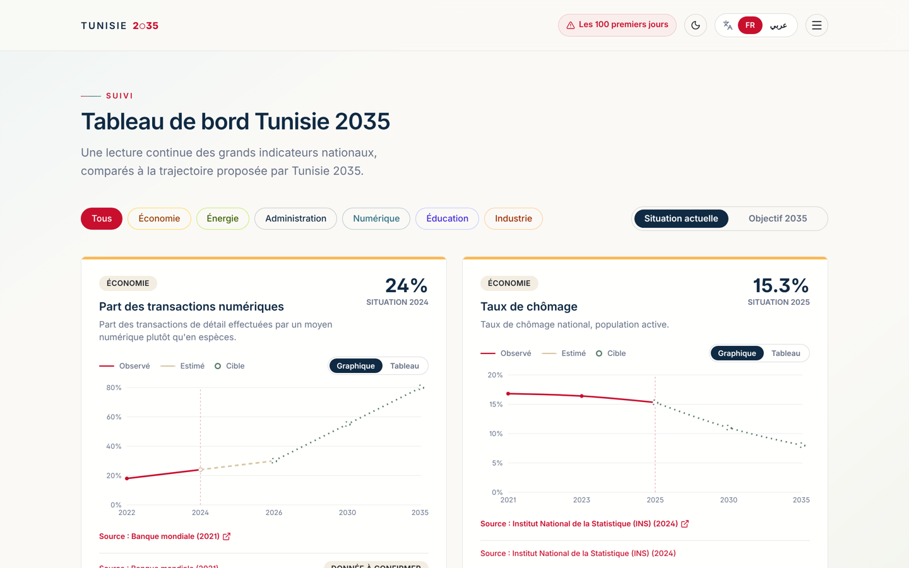
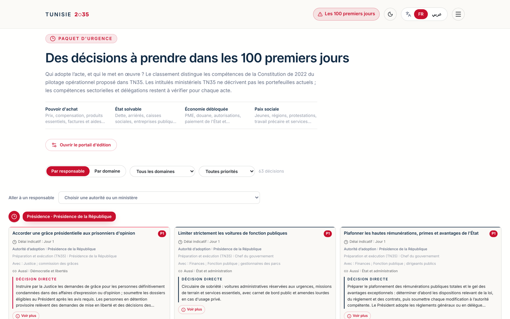
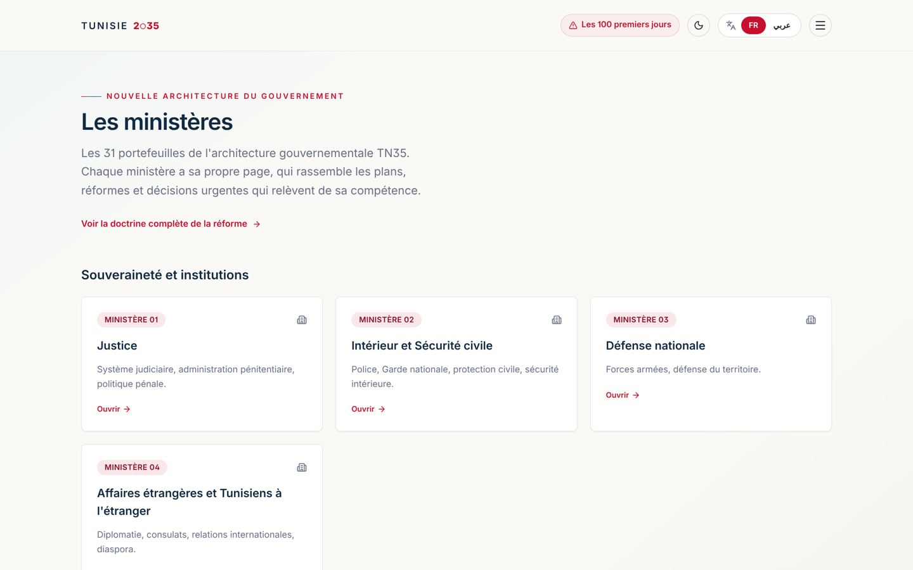
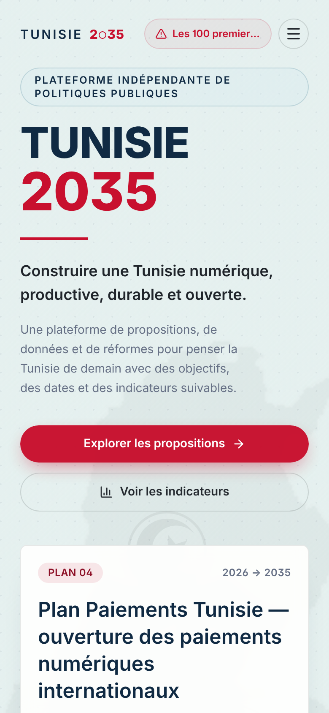
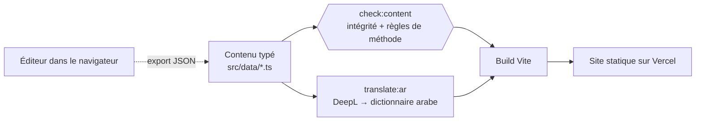

[English](README.md) · Français

# Tunisie 2035

**Une plateforme indépendante de politiques publiques : plans, réformes et indicateurs structurés pour la Tunisie de la prochaine décennie**

Application web · Français et arabe (RTL) · Site statique, déployé sur Vercel

[Site en ligne](https://tn2035.vercel.app) · [Captures d'écran](#captures-décran) · [Comment c'est construit](#comment-cest-construit)

---

> **Le code source est privé.** Ce dépôt présente le projet : ce qu'il fait, comment il est construit et les choix techniques derrière. Je présente volontiers le code en entretien.

## L'idée

Les propositions de politiques publiques vivent généralement dans de longs PDF et des tribunes : difficiles à parcourir, rarement sourcées ligne par ligne, et presque jamais rattachées à des objectifs mesurables.

**Tunisie 2035 transforme des idées de politiques publiques en fiches structurées et navigables.** Chaque plan et chaque réforme suit le même modèle (problème, causes, options dont « ne rien faire », mécanisme, précédents internationaux et leurs limites, faisabilité, acteurs, risques, KPI), et chaque chiffre est étiqueté *constaté*, *estimation* ou *objectif* et relié à une source.

## Mon rôle

Projet personnel, conçu et développé **de bout en bout, seul** : modèle de contenu, méthode d'analyse, design de l'interface, front-end, chaîne bilingue, outillage et déploiement.

## Ce qu'on trouve sur le site

- **Des plans stratégiques** (ce que l'État veut construire), par exemple un plan solaire national, les paiements numériques, l'export de services
- **Des réformes** (les règles à changer), chacune avec un diagnostic, le cadre juridique existant, les décisions publiques, un paquet législatif, des coûts et des KPI
- **« Les 100 premiers jours »** : plus de 60 décisions urgentes, filtrables par domaine, par priorité et par l'autorité qui adopte chaque acte
- **Une proposition d'architecture gouvernementale** de 31 ministères, chacun avec sa page qui rassemble les plans, réformes et décisions qui le concernent
- **Un tableau de bord** d'indicateurs nationaux, montrant sur un même graphique la trajectoire constatée, les estimations et les objectifs 2030/2035
- **PDF en un clic** : chaque plan et chaque réforme a une mise en page A4 imprimable
- **Une version arabe complète** avec mise en page de droite à gauche, et des thèmes clair et sombre

## Captures d'écran

L'interface est en français et en arabe, les langues de ses lecteurs.

**Accueil**

**En arabe, de droite à gauche**

**Une page de plan** : un résumé « en 60 secondes », puis diagnostic, mesures, impacts, risques et feuille de route

**Une page de réforme** : des chapitres, du diagnostic au paquet législatif et aux sources

**Tableau de bord des indicateurs** : données constatées, estimations et objectifs sont tracés différemment pour ne jamais être confondus

**« Les 100 premiers jours »** : chaque décision indique qui l'adopte et qui la met en œuvre

| Ministères | Mobile |
|---|---|
|  |  |

## Comment c'est construit

- **Le contenu, c'est du code.** Chaque plan et chaque réforme est un fichier TypeScript typé. Le système de types impose le modèle : une section manquante ou un champ mal nommé devient une erreur de build au lieu d'un trou silencieux sur la page.
- **Une méthode d'analyse écrite, vérifiée par un script.** Une doctrine en 10 questions (problème, causes, cadre existant, options, mécanisme, comparaison internationale, faisabilité, acteurs, risques, mesure du succès) est contrôlée par `check:content` : chaque `sourceId` doit exister, chaque statistique doit porter un type de donnée, chaque réforme doit avoir une option « ne rien faire » et au moins un KPI de résultat.
- **Les sources dans un registre.** Plus de 80 sources sont rassemblées dans un fichier central, chacune avec sa date de consultation, et les pages y renvoient par identifiant.
- **Chaîne bilingue.** Le français est la langue source. Un script génère le dictionnaire arabe via DeepL, avec des corrections manuelles pour les termes délicats ; l'interface passe en RTL à la volée.
- **Pas de backend, par choix.** Le site est 100 % statique. Un éditeur dans le navigateur permet de préparer des modifications de plans et de réformes en local, puis de les exporter en JSON pour les committer : le contenu publié est toujours exactement celui du dépôt.
- **Recherche assistée par IA, gardée hors ligne.** Un outil réservé au développement envoie une idée brute à Gemini avec la recherche Google et renvoie une critique structurée (ambiguïtés, pour et contre, budget, légalité, alternatives). Il n'est jamais déployé sur le site public.

## Stack technique

| | |
|---|---|
| **Front-end** | React 19, TypeScript, Vite, React Router, Tailwind CSS v4 |
| **Interface** | Framer Motion, Recharts, icônes Lucide, react-markdown |
| **i18n** | Français en source, arabe généré avec DeepL + corrections manuelles, mise en page RTL |
| **Outillage** | Vérificateur d'intégrité du contenu sur mesure (tsx), Oxlint |
| **Hébergement** | Vercel (statique, réécritures SPA) |

## En chiffres

| | |
|---|---|
| Lignes de TypeScript | ~30 000 |
| Plans stratégiques | 10 |
| Réformes | 18 |
| Décisions urgentes | 60+ |
| Ministères dans l'architecture proposée | 31 |
| Sources référencées | 80+ |

## État du projet

En ligne et en croissance : les nouveaux plans et réformes suivent la même méthode, et chacun n'est publié qu'une fois qu'il répond aux dix questions.

---

Réalisé par **Anas Sfar** · [LinkedIn](https://www.linkedin.com/in/anas-sfar-331071370/) · [anassfar.fr@gmail.com](mailto:anassfar.fr@gmail.com)

