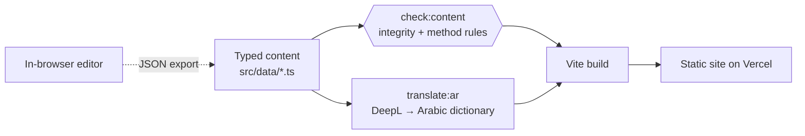

English · [Français](README.fr.md)

# Tunisie 2035

**An independent public-policy platform: structured plans, reforms and indicators for Tunisia's next decade**

Web app · French & Arabic (RTL) · Static, deployed on Vercel

[Live site](https://tn2035.vercel.app) · [Screenshots](#screenshots) · [How it's built](#how-its-built)

---

> **The source code is private.** This repository presents the project: what it does, how it is built, and the engineering decisions behind it. I'm happy to walk through the code in an interview.

## The idea

Policy proposals usually live in long PDFs and opinion pieces: hard to navigate, rarely sourced line by line, and almost never tied to measurable targets.

**Tunisie 2035 turns policy ideas into structured, navigable records.** Every plan and reform follows the same template (problem, causes, options including "do nothing", mechanism, international precedents and their limits, feasibility, stakeholders, risks, KPIs) and every figure is labelled as *observed*, *estimate* or *target* and linked to a source.

## My role

Personal project, designed and built **end to end on my own**: content model, analysis method, UI design, front-end, bilingual pipeline, tooling and deployment.

## What's on the site

- **Strategic plans** (what the State wants to build), e.g. a national solar plan, digital payments, service exports
- **Reforms** (the rules to change), each with a diagnosis, existing legal framework, policy decisions, legislative package, costs and KPIs
- **"100 first days"**: 60+ urgent decisions, filterable by domain, priority and the authority that adopts each act
- **A proposed government architecture** of 31 ministries, each with its own page gathering the plans, reforms and decisions it owns
- **A dashboard** of national indicators, showing the observed trajectory, estimates and 2030/2035 targets on the same chart
- **One-click PDF**: every plan and reform has an A4 print layout
- **Full Arabic version** with right-to-left layout, plus light and dark themes

## Screenshots

The interface is in French and Arabic, the languages of its readers.

**Home**

**Arabic, right-to-left**

**A plan page**: a "60-second" summary, then diagnosis, measures, impacts, risks and roadmap

**A reform page**: chapters from diagnosis to legislative package and sources

**Indicator dashboard**: observed data, estimates and targets are drawn differently so they are never confused

**"100 first days"**: each decision names who adopts it and who carries it out

| Ministries | Mobile |
|---|---|
|  |  |

## How it's built

- **Content as code.** Each plan and reform is a typed TypeScript file. The type system enforces the template, so a missing section or a misnamed field is a build error rather than a silent gap on the page.
- **A written analysis method, enforced by a script.** A 10-question doctrine (problem, causes, existing framework, options, mechanism, international comparison, feasibility, stakeholders, risks, success metrics) is checked by `check:content`: every `sourceId` must exist, every statistic must carry a data type, every reform needs a "do nothing" option and at least one outcome KPI.
- **Sources as a registry.** 80+ sources live in one central file, each with the date it was consulted, and pages reference them by id.
- **Bilingual pipeline.** French is the source language. A script generates the Arabic dictionary through DeepL, with manual overrides for terms that need care; the UI switches to RTL at runtime.
- **No backend by design.** The site is 100% static. An in-browser editor lets you draft changes to plans and reforms locally, then export them as JSON to be committed, so the published content is always exactly what is in the repository.
- **AI-assisted research, kept offline.** A development-only tool sends a raw policy idea to Gemini with Google Search grounding and returns a structured critique (ambiguities, pros and cons, budget, legality, alternatives). It never ships to the public site.

## Tech stack

| | |
|---|---|
| **Front-end** | React 19, TypeScript, Vite, React Router, Tailwind CSS v4 |
| **UI** | Framer Motion, Recharts, Lucide icons, react-markdown |
| **i18n** | French source, Arabic generated with DeepL + manual overrides, RTL layout |
| **Tooling** | Custom content-integrity checker (tsx), Oxlint |
| **Hosting** | Vercel (static, SPA rewrites) |

## In numbers

| | |
|---|---|
| Lines of TypeScript | ~30,000 |
| Strategic plans | 10 |
| Reforms | 18 |
| Urgent decisions | 60+ |
| Ministries in the proposed architecture | 31 |
| Referenced sources | 80+ |

## Status

Live and growing: new plans and reforms are added following the same method, and each one is published only once it answers all ten questions.

---

Built by **Anas Sfar** · [LinkedIn](https://www.linkedin.com/in/anas-sfar-331071370/) · [anassfar.fr@gmail.com](mailto:anassfar.fr@gmail.com)

